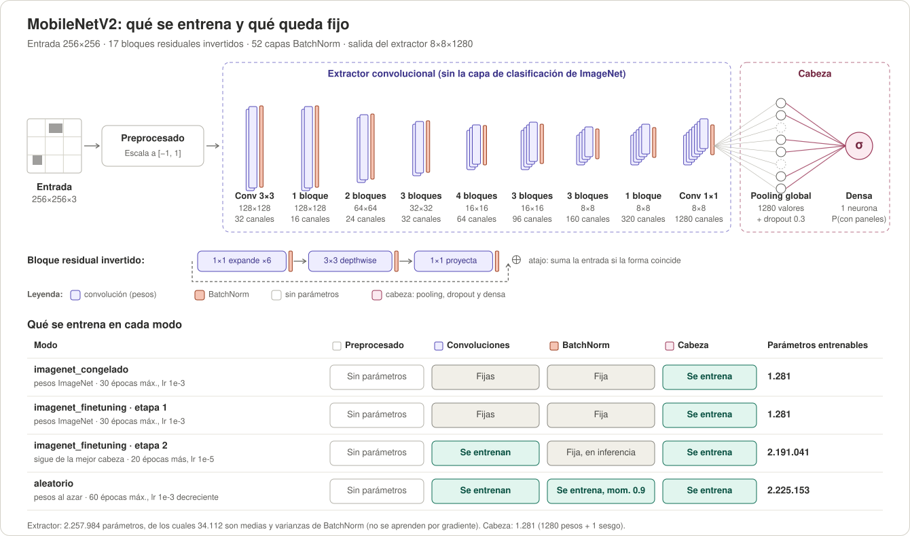
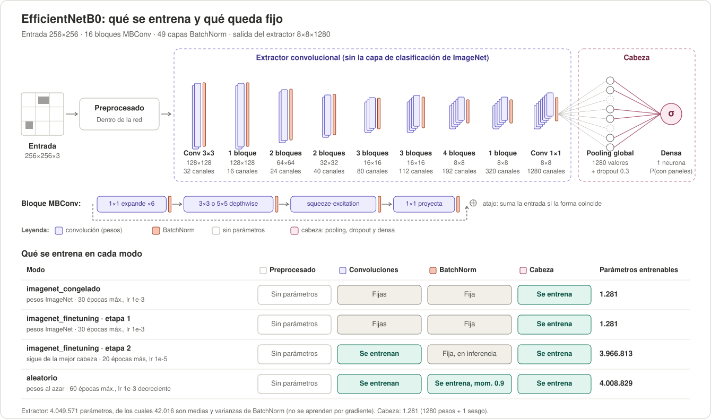
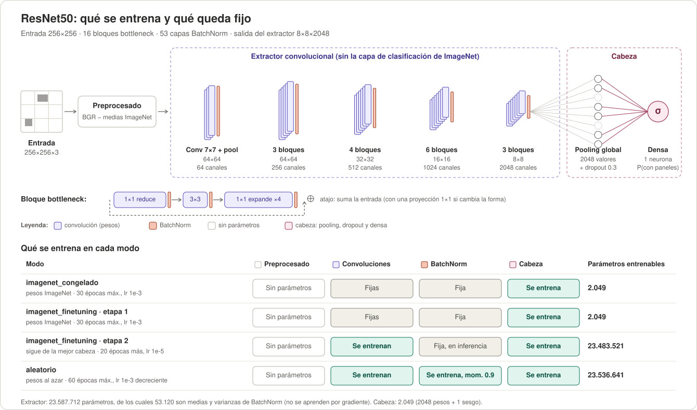

# PDI-TP · Paneles solares: clasificación y detección

Trabajo práctico de **Procesamiento de Imágenes** (grupo 5). Consigna:
[docs/Consigna_Paneles_Solares.pdf](docs/Consigna_Paneles_Solares.pdf) · resumen de requisitos:
[docs/alcance.md](docs/alcance.md) · instalación, trabajo en local y verificaciones:
[INSTRUCCIONES.md](INSTRUCCIONES.md) · normas para agentes (Claude, Codex, etc.): [AGENTS.md](AGENTS.md).

## De qué se trata

Encontrar paneles solares en imágenes aéreas sirve, por ejemplo, para que una distribuidora eléctrica sepa
dónde hay generación propia. El mismo dataset se resuelve de dos maneras y se comparan:

1. **Clasificación**: ¿la imagen tiene paneles? (sí / no). Redes de Keras (MobileNetV2, EfficientNetB0 y
   ResNet50), comparando pesos de ImageNet contra aleatorios y extractor congelado contra fine-tuning.
2. **Detección**: ¿dónde está cada panel? YOLOv8n y YOLO11n (más YOLO26n, opcional), entrenando toda la red
   contra congelar una parte.
3. **Comparación**: el detector también se usa como clasificador (si detecta al menos un panel, la imagen
   "tiene paneles") y se compara con los clasificadores sobre las mismas imágenes de validación.

Métricas: matriz de confusión, accuracy, precision, recall y F1 para clasificación, más F1 macro, balanced
accuracy, recall sin paneles y AUC para evaluar el desbalance; mAP50, mAP50-95 y curva precisión-recall para
detección. Se entrega un informe con comparaciones y conclusiones.

## Receta común de clasificación

Las tres redes se entrenan con la misma receta y cambian solo la arquitectura, para que la comparación valga
(detalle y discusión en el [issue #15](https://github.com/candeperles/PDI-TP/issues/15)). Los tres notebooks
implementan `comun_v2`; cada corrida nueva guarda ese valor en `params.receta` dentro de `config.json`.

| | `imagenet_congelado` | `imagenet_finetuning` | `aleatorio` |
|---|---|---|---|
| Qué se entrena | solo la cabeza | todo el extractor menos BatchNorm, desde la mejor cabeza | toda la red desde cero |
| LR (Adam) | 1e-3 | 1e-5 | 1e-3, a la mitad tras 3 épocas sin mejorar |
| Épocas máximas | 30 | 20 adicionales | 60 |
| Early stopping (`val_loss`) | paciencia 10 | paciencia 10 | paciencia 10, cuenta desde la época 20 |
| Momentum de BatchNorm | el de cada red | el de cada red | 0.9 |

Común a todos: entrada 256×256 (el tamaño original), batch 32, dropout 0.3, umbral 0.5, semilla 42,
`aumentacion.google_maps` y pesos de muestra por fuente × clase. El preprocesado es el de cada red.

**Val elige el checkpoint y también se usa para reportar**, así que las métricas son optimistas: decirlo en el
informe. Para volver a correr un notebook sin mezclar resultados, ver
[Dónde quedan los resultados](#dónde-quedan-los-resultados).

### Qué se entrena en cada red

Las tres redes tienen la misma estructura: preprocesado → extractor convolucional de Keras sin su capa de
clasificación de ImageNet → cabeza propia (pooling global, dropout 0.3 y una neurona sigmoide). Cambia solo el
extractor. En cada diagrama, la tabla de abajo muestra qué parte se entrena en cada modo; los parámetros
entrenables salen de las arquitecturas de Keras con entrada 256×256.

- **Fine-tuning en dos etapas:** primero se entrena solo la cabeza (igual que `imagenet_congelado`) y después
  se descongela el extractor con lr 1e-5. Así los gradientes de una cabeza al azar no arruinan los pesos de
  ImageNet.
- **BatchNorm queda fija con ImageNet, aun en fine-tuning:** no se entrenan sus γ y β, y la red se llama con
  `training=False`, así que usa las medias y varianzas de ImageNet y no las de cada batch de 32.
- **En `aleatorio` BatchNorm sí aprende**, con momentum 0.9 para que sus estadísticas se adapten rápido.

<details open>
<summary><b>MobileNetV2</b></summary>



</details>

<details>
<summary><b>EfficientNetB0</b></summary>



</details>

<details>
<summary><b>ResNet50</b></summary>



</details>

## Estado de implementación

Revisado contra el código de `main` el **6/11/2026**. Esta tabla describe lo implementado. El estado del
entrenamiento se confirma por separado con los archivos de cada modo guardados en Drive; al actualizarlo,
registrar la receta y la fecha de la corrida consultada.

| Etapa | Notebook | Estado |
|---|---|---|
| Exploración del dataset | `01_exploracion` | Hecho |
| Validación del dataset y revisión de anotaciones | `02_validacion_datos`, `03_revision_anotaciones` | Hecho; criterios en [docs/criterios_datos.md](docs/criterios_datos.md) |
| Clasificación: MobileNetV2 | `04_clasificacion_mobilenetv2` | `comun_v2` implementada en los tres modos: `imagenet_congelado`, `imagenet_finetuning` y `aleatorio` |
| Clasificación: ResNet50 | `05_clasificacion_resnet50` | `comun_v2` implementada en los tres modos, con reanudación desde `ultimo.keras` |
| Clasificación: EfficientNetB0 | `06_clasificacion_efficientnet` | `comun_v2` implementada en los tres modos; guarda cada modo antes de empezar el siguiente y carga la mejor cabeza para fine-tuning |
| Receta común de clasificación | — | Implementada en las tres redes; para comparar, verificar las corridas completas con `params.receta = "comun_v2"` en Drive |
| Marca de agua de Google Maps (issue #7) | `11_marca_de_agua`, `12_marca_de_agua_efecto` | **Diagnóstico listo en `12`, falta correrlo** para las CNN y los YOLO: mide si los modelos actuales usan la marca, antes de decidir si hay que neutralizarla. **Ubicada:** aparece en 49 de las 172 imágenes de Jamaica y en ninguna de las otras fuentes; ocupa desde la fila 222 para abajo (barra de atribución y logo). En todo el dataset, "marca → sin paneles" acierta el 63 % contra el 13 % sin marca, porque solo aparece en Jamaica. **Falta:** elegir entre tapar esa franja en todas las imágenes o pegar marcas falsas como augmentation, y medir el efecto en Jamaica |
| Detección: YOLOv8n | `08_deteccion_yolov8n` | Dos modos implementados con entrada de **640 px**, evaluación en val/Jamaica y salida como clasificador |
| Detección: YOLO11n | `09_deteccion_yolo11n` | Dos modos implementados con la **misma receta de 640 px** que YOLOv8n; cambia la arquitectura y la cantidad de módulos del backbone congelados |
| Detección: YOLO26n (opcional, issue #37) | `16_deteccion_yolo26n` | Dos modos implementados con la **misma receta de 640 px**, en un entorno propio (`requirements-yolo26.txt`). **Falta entrenar** en Colab |
| Detector como clasificador y comparación final | `10_comparacion_final` | Implementado; se puede ejecutar con las corridas disponibles, informa cuáles faltan y calcula intervalos bootstrap y diferencias pareadas sobre val y Jamaica |
| Galería de errores | `13_galeria_errores` | Visor de imagen completa y zoom común: anotaciones y cajas predichas lado a lado, confianza/IoU, omisiones, detecciones sin correspondencia y cajas cercanas mal ajustadas; incluye decisiones de las CNN |
| Variables de clasificación (issue #35) | `14_variables_clasificacion` | Siete variantes implementadas, selección efectiva de pesos, métricas por fuente, diferencias pareadas y curvas; **pendiente ejecutar en Colab y analizar resultados** |
| Tamaño de entrada de YOLOv8n (issue #36) | `15_deteccion_yolov8n_256` | Control a 256 px implementado, análisis por tamaño, diferencias pareadas, ejemplos y costos; **pendiente ejecutar en Colab y analizar resultados** |
| Informe | — | Pendiente |
| Página interactiva para el cierre | — | Idea: un módulo que muestre cómo se generan las cajas (candidatas → filtrado → finales) y otro con la red calculando en vivo (mapas de activación capa por capa). Se arma al final, con los resultados reales |

**Cómo confirmar las corridas actuales:** abrir `10_comparacion_final` y revisar la tabla de corridas,
fechas, receta y modos faltantes. Se esperan **9 modos de clasificación y 4 de detección**, más el baseline
como referencia; los 2 modos de YOLO26n son opcionales y, si están, entran en la comparación. Una corrida completa incluye pesos, `config.json`, `metricas.json` y
`predicciones_val.csv` sobre las 162 imágenes de val; el baseline no necesita pesos.

Los registros históricos no equivalen a la receta actual: las métricas de Jamaica del 27/10 en
[evaluacion_jamaica.md](docs/evaluacion_jamaica.md) son anteriores a `comun_v2`, y las primeras corridas de
MobileNetV2 del 2/11 usaron `comun`, según el
[issue #15](https://github.com/candeperles/PDI-TP/issues/15#issuecomment-6586593873). Las dos variantes de
YOLOv8n registradas el 27/10 usaban 256 px; verificar `params.receta.imgsz = 640` antes de compararlas con
YOLO11n. Para dar por entrenada una receta nueva, comprobar sus archivos en Drive y registrar modelo,
modo, fecha y configuración; no inferirlo de estos antecedentes.

## Datos

- **Dataset `grupo_5`**: 900 imágenes aéreas PNG de 256×256 con etiquetas YOLO. El código distingue cinco
  nombres de fuente: `solarpanels_hd`, `PV01`, `kingston`, `kingston2` y `geo`. ~85 % tiene paneles. No está
  en el repo: los notebooks lo descargan solos (detalles en [INSTRUCCIONES.md](INSTRUCCIONES.md#descarga-del-dataset)).
- **Split train/val compartido**: `splits/train.txt` y `splits/val.txt` (738 / 162, **82/18 efectivo**).
  Se buscó un 80/20 por grupos espaciales, estratificado por fuente y con/sin paneles; los grupos se conservan
  completos (recortes vecinos de una misma imagen grande quedan del mismo lado, para que no haya fuga).
  Se carga con `split.cargar_split(rutas)`. **Todos usan el
  mismo**; no regenerarlo sin acuerdo del equipo (`scripts/make_split.py`).
- **Clases**: en `solarpanels_hd` los IDs 0/1/2 son la *confianza* de la anotación (alta/moderada/baja),
  no tipos de panel. Se trabaja con una sola clase `panel`. Ver [docs/criterios_datos.md](docs/criterios_datos.md).
- **Test previsto:** clasificación y detección sobre capturas de Kingston del mismo tamaño y zoom que las
  originales, con mayoría sin paneles (issue #7). Jamaica tiene 172 imágenes: 149 en train y **23 en val**
  (11 con paneles y 12 sin). Reportar ese subconjunto además del val completo. N06/N16 siguen pendientes
  de segunda revisión; conservar la referencia provisional y los originales.

## Puesta en marcha (una sola vez por persona)

1. **Carpeta compartida en Drive.** Una sola persona crea la carpeta `PDI-TP` y la comparte con el resto
   como Editor. Cada persona entra a *Compartidos conmigo* → clic derecho en `PDI-TP` → *Organizar →
   Agregar acceso directo* → *Mi unidad*. Tiene que quedar exactamente en `Mi unidad/PDI-TP`.
   - **No crear otra carpeta llamada `PDI-TP`** en tu Drive: Drive permite nombres repetidos y Colab puede
     agarrar la equivocada (vas a ver la carpeta vacía y "desaparecen" los resultados del resto).
   - Montar Drive en Colab **con la misma cuenta** a la que se compartió la carpeta.
2. **Si trabajás con git en local (con o sin IA)**, una vez por clon: activar el chequeo previo a cada commit
   e instalar la CLI de GitHub para abrir PRs ([cli.github.com](https://cli.github.com/)):

   ```bash
   git config core.hooksPath .githooks
   ```

   ```bash
   gh auth login
   ```

## Correr un notebook en Colab

1. Abrirlo con su botón **Open in Colab** (tabla de abajo). Siempre abre la última versión de `main`.
2. Para entrenar (`04`, `05`, `06`, `08`, `09`, `14`, `15`): *Entorno de ejecución → Cambiar tipo de entorno → T4* (GPU).
   Los notebooks de datos y la comparación final no necesitan GPU.
3. *Entorno de ejecución → Ejecutar todas*. La celda de setup clona o actualiza el repo, instala
   las dependencias que corresponden y descarga el dataset si falta. Los notebooks que entrenan montan
   Drive; los que leen resultados (`10`, `12` y `13`) también lo montan, en solo lectura. Los de datos usan
   `entorno.preparar(usar_drive=False)`. Si Colab pide reiniciar por cambios de paquetes, reiniciar y volver
   a correr desde el setup.

Usar sesiones separadas para clasificación (`requirements-training.txt`, TensorFlow) y detección
(`requirements-detection.txt`, PyTorch/Ultralytics; YOLO26n usa `requirements-yolo26.txt`). No mezclar esos entornos con `requirements.txt`
(exploración). Antes de entrenar, revisar la receta de las corridas existentes: `REPETIR = True` archiva
las anteriores y vuelve a entrenar; una vez iniciada la receta correcta, volver a `False` para conservar
los modos completos. Ver [Repetir o recuperar un entrenamiento](#repetir-o-recuperar-un-entrenamiento).

No hay que poner ningún nombre: los resultados se guardan por modelo y modo, no por persona.

### Notebooks

**Datos**

| Notebook | |
|---|---|
| `01_exploracion` — EDA: balance de clases, fuentes, cajas, split | [](https://colab.research.google.com/github/candeperles/PDI-TP/blob/main/notebooks/01_exploracion.ipynb) |
| `02_validacion_datos` — validación de archivos, cajas, duplicados y split | [](https://colab.research.google.com/github/candeperles/PDI-TP/blob/main/notebooks/02_validacion_datos.ipynb) |
| `03_revision_anotaciones` — casos dudosos, muestra de negativos y criterios | [](https://colab.research.google.com/github/candeperles/PDI-TP/blob/main/notebooks/03_revision_anotaciones.ipynb) |
| `11_marca_de_agua` — dónde aparece la marca de agua de Google Maps, si se asocia con la clase y qué zona tapar (issue #7) | [](https://colab.research.google.com/github/candeperles/PDI-TP/blob/main/notebooks/11_marca_de_agua.ipynb) |

**Clasificación (consigna, ítem 2)**

| Notebook | |
|---|---|
| `04_clasificacion_mobilenetv2` — MobileNetV2: congelado, fine-tuning y sin preentrenamiento | [](https://colab.research.google.com/github/candeperles/PDI-TP/blob/main/notebooks/04_clasificacion_mobilenetv2.ipynb) |
| `05_clasificacion_resnet50` — ResNet50: congelado, fine-tuning de todo el extractor y pesos aleatorios | [](https://colab.research.google.com/github/candeperles/PDI-TP/blob/main/notebooks/05_clasificacion_resnet50.ipynb) |
| `06_clasificacion_efficientnet` — EfficientNetB0: congelado, fine-tuning y pesos aleatorios | [](https://colab.research.google.com/github/candeperles/PDI-TP/blob/main/notebooks/06_clasificacion_efficientnet.ipynb) |

**Detección (consigna)**

| Notebook | |
|---|---|
| `08_deteccion_yolov8n` — YOLOv8n: red completa y backbone congelado, mAP en val/Jamaica y detector como clasificador | [](https://colab.research.google.com/github/candeperles/PDI-TP/blob/main/notebooks/08_deteccion_yolov8n.ipynb) |
| `09_deteccion_yolo11n` — YOLO11n: lo mismo que el 08, con la misma receta (640 px) | [](https://colab.research.google.com/github/candeperles/PDI-TP/blob/main/notebooks/09_deteccion_yolo11n.ipynb) |
| `16_deteccion_yolo26n` — YOLO26n (opcional en la consigna): lo mismo que el 09, con su propio entorno | [](https://colab.research.google.com/github/candeperles/PDI-TP/blob/main/notebooks/16_deteccion_yolo26n.ipynb) |

**YOLO26n no usa el entorno de abajo:** instala `requirements-yolo26.txt` (Ultralytics 8.4.184), porque la
versión del 08 y el 09 no incluye YOLO26. Sus `modelo.pt` **no se abren con 8.3.221**: los carga sin error,
pero predice otras cajas. Por eso `12_marca_de_agua_efecto` no sirve hoy para YOLO26n. Diferencias de la
receta: [detección con YOLOv8n](docs/deteccion_yolov8n.md#yolo26n).

El 08 y el 09 usan una sesión nueva de Colab con GPU T4 y `requirements-detection.txt` (PyTorch), el dataset
existente y el split fijo. La entrada es **640 px en los tres**: Ultralytics agranda las imágenes originales
de 256×256. Comparten batch 16, hasta 50 épocas, paciencia 10, AdamW y LR inicial 0.001; la receta completa
está en `RECETA` y se guarda en `config.json`. Guía: [detección con YOLOv8n](docs/deteccion_yolov8n.md);
vale también para YOLO11n, salvo que congelar el backbone es `freeze=11` (módulos 0–10) en vez de
`freeze=10` (módulos 0–9).

Como clasificadores usan umbral **0.25** sobre la máxima confianza de panel por imagen (0 si no hay
detecciones). Ese puntaje no es una probabilidad calibrada. La evaluación de cajas usa confianza mínima
0.001, NMS IoU 0.7 y hasta 300 detecciones; son parámetros distintos del umbral de clasificación.

**Estudios de una variable (consigna, issues #35 y #36)**

| Notebook | |
|---|---|
| `14_variables_clasificacion` — siete variantes de MobileNetV2: augmentation, pesos, LR y early stopping. Referencia `imagenet_finetuning/comun_v2`; guarda como `variables_v1`, fuera de la comparación de arquitecturas | [](https://colab.research.google.com/github/candeperles/PDI-TP/blob/main/notebooks/14_variables_clasificacion.ipynb) |
| `15_deteccion_yolov8n_256` — control de entrada 256 frente a 640, mismo entrenamiento COCO completo. Guarda `coco_completo_256`; compara detección, clasificación, recall por tamaño, costos y ejemplos reales | [](https://colab.research.google.com/github/candeperles/PDI-TP/blob/main/notebooks/15_deteccion_yolov8n_256.ipynb) |

Usan sesiones separadas de Colab con T4 (14: TensorFlow; 15: PyTorch). Antes de entrenar,
verifican que la referencia completa en Drive tenga la receta esperada. No modifican los notebooks 04/08
ni reentrenan las referencias. `REPETIR=False` conserva modos completos con la misma configuración;
`True` archiva. Un modo incompleto del 14 comienza otra vez; el 15 retoma `last.pt` como el 08.
Para analizar sin GPU, poner `ENTRENAR=False` antes del setup (`MEDIR_INFERENCIA=False` en 15).
El análisis no escribe resultados; estos dos notebooks mantienen permiso de entrenamiento al montar Drive.

Si el 14 falla al guardar después de entrenar, **no reiniciar la sesión ni poner `REPETIR=True`**:
conserva el modelo, las predicciones y el historial en `PENDIENTES_GUARDADO` hasta completar el guardado.
Recuperar el acceso con `rutas = entorno.preparar()` y ejecutar `guardar_pendiente("sin_aug")`
(usar el modo que falló). Después, la celda del bucle continúa los modos pendientes sin repetir los
completos con `REPETIR=False`. Este rescate es solo en memoria: se pierde al reiniciar Colab.

**Todavía no hay resultados de estos estudios verificados:** falta ejecutar las variantes y registrar
fecha, commit y entorno en sus issues. Val selecciona checkpoints y también reporta; Jamaica tiene 23 imágenes.
Las diferencias usan bootstrap pareado por imagen: un intervalo que incluye cero no acredita una mejora.
El recall por tamaño no reemplaza el mAP; el notebook 15 no calcula un intervalo de mAP. La inferencia se
mide opcionalmente en la misma T4, batch 1, FP32, con calentamiento y sincronización de CUDA.
No cambiar `comun_v2` sin acuerdo en #15.

**Comparación final (consigna)**

| Notebook | |
|---|---|
| `10_comparacion_final` — compara clasificadores y detectores usados como clasificadores sobre val y Jamaica, con intervalos bootstrap y diferencias pareadas, más el mAP de los detectores. No entrena: lee los resultados en solo lectura | [](https://colab.research.google.com/github/candeperles/PDI-TP/blob/main/notebooks/10_comparacion_final.ipynb) |
| `12_marca_de_agua_efecto` — si los modelos ya entrenados usan la marca de agua: tapa la marca en Jamaica y la pega en imágenes de otras fuentes, cada prueba con su control, y mide cuánto cambia la probabilidad (issue #7). No entrena: lee los modelos en solo lectura, una sesión por familia (CNN o YOLO) | [](https://colab.research.google.com/github/candeperles/PDI-TP/blob/main/notebooks/12_marca_de_agua_efecto.ipynb) |
| `13_galeria_errores` — muestra la imagen con las cajas anotadas y predichas, un zoom de cada error y las decisiones de las CNN; permite filtrar Jamaica, modelo, confianza y tipo de error. Sin GPU, en solo lectura | [](https://colab.research.google.com/github/candeperles/PDI-TP/blob/main/notebooks/13_galeria_errores.ipynb) |

No necesita GPU. Correrlo cada vez que haya corridas nuevas: incluye las CNN completas con
`params.receta = "comun_v2"`, los detectores completos y el baseline disponible. Las CNN de otra receta
se listan, pero se excluyen de la comparación. **Los detectores requieren `params.receta.imgsz = 640`:** los controles a 256 px y las corridas
sin resolución registrada se listan, pero quedan excluidos automáticamente de la comparación final.

Ordena val por F1 macro y Jamaica por balanced accuracy, con AUC como desempate. Muestra también recall
sin paneles, AUC e intervalos del 95 %. Para comparar CNN y detectores, mirar especialmente el AUC porque
no depende de sus distintos umbrales. Las diferencias se calculan sobre las mismas imágenes: si su
intervalo incluye 0, no afirmar superioridad. Val también eligió checkpoints y el bootstrap no elimina
ese optimismo. Con solo 23 imágenes de Jamaica, diferencias pequeñas pueden ser ruido.

**Revisar dónde falla cada modelo:** ejecutar `13_galeria_errores` sin GPU. Lee `cajas_val.csv` y
`predicciones_val.csv` de las corridas completas; no necesita cargar pesos ni volver a hacer inferencia.
Muestra la misma imagen y el mismo zoom para la referencia y hasta dos detectores. Las cajas llevan
identificador, confianza y, si hay correspondencia, IoU. Se pueden ver omisiones, falsas detecciones,
duplicados y cajas cercanas con IoU insuficiente, además de errores de presencia de las CNN. N06/N16
quedan ocultos por defecto por su referencia provisional. Las CNN requieren `comun_v2` y los YOLO, 640 px;
una opción permite inspeccionar detectores históricos con otra resolución, sin tratarlos como una
comparación de arquitecturas. Si falta una exportación de cajas, se informa; no se interpreta como cero
detecciones. Las cuentas por caja son diagnósticas y no reemplazan el mAP.

**Vista web de demostración:** [galería con filtros, superposición y zoom](docs/galeria/README.md).
Con el repo descargado, abrir `docs/galeria/index.html` en el navegador. Usa las imágenes del dataset
local o permite elegir su carpeta; no hace falta servidor. Las cajas predichas son **simuladas** para
mostrar el visor. Para revisar resultados reales, se mantiene el notebook `13_galeria_errores` de arriba.

## Dónde quedan los resultados

**Todos los notebooks que entrenan guardan igual: una carpeta por modelo y por modo**, nunca por persona. Lo hace
`resultados.guardar_corrida(...)` de [`pdi_tp/resultados.py`](pdi_tp/resultados.py):

```
Mi unidad/PDI-TP/
├── resultados/                         ← solo modelos
│   ├── mobilenetv2/
│   │   ├── imagenet_congelado/
│   │   │   ├── modelo.keras            ← pesos (o .pt / .joblib según el framework)
│   │   │   ├── metricas.json           ← accuracy, precision, recall, F1, F1 macro, matriz, por fuente y solo Jamaica
│   │   │   ├── predicciones_val.csv    ← predicción contra el real: archivo, fuente, y_real,
│   │   │   │                              probabilidad, prediccion, acierto (las 162 imágenes de val)
│   │   │   ├── config.json             ← modelo, modo, parámetros, fecha y commit del repo
│   │   │   └── historia.csv, curvas…   ← opcionales
│   │   ├── imagenet_finetuning/
│   │   └── aleatorio/
│   ├── efficientnetb0/
│   ├── resnet50/
│   ├── yolov8n/
│   │   ├── coco_completo/
│   │   └── coco_backbone_congelado/
│   ├── yolo11n/
│   │   ├── coco_completo/
│   │   └── coco_backbone_congelado/
│   ├── yolo26n/                        ← opcional
│   │   ├── coco_completo/
│   │   └── coco_backbone_congelado/
│   └── baseline/siempre_con_paneles/
├── analisis/                           ← tablas auxiliares de notebooks que entrenan (p. ej. manifiesto de ResNet50)
└── cache/                              ← intermedios reutilizables (features, folds); no son resultados
```

**Solo los notebooks que entrenan crean carpetas en Drive**, y recién cuando guardan algo. El EDA, la
validación y la revisión de anotaciones no montan Drive: correrlos no crea nada en la carpeta compartida
(sus reportes quedan solo en la sesión de Colab). La comparación final, el diagnóstico de marca de agua
y la galería de errores sí montan Drive, pero en **solo lectura** (`entorno.preparar(solo_lectura=True)`):
no pueden crear ni guardar corridas ni escribir archivos.
Los YOLO agregan `modelo.pt`, `metricas_deteccion.json`, `cajas_val.csv`, checkpoints y gráficas de cajas;
las métricas de detección también quedan en `metricas.json`, dentro de `extra.deteccion`.

- **Siempre las mismas métricas, calculadas de la misma manera**, y `y_real` sale de las etiquetas del
  dataset, no del notebook. Si falta algo (pesos, una imagen de val, una columna), `guardar_corrida` frena
  con un error en vez de dejar una carpeta incompleta.
- **Comparar todo el equipo**: `resultados.cargar_corridas(rutas)` (una fila por modelo/modo) y
  `resultados.cargar_predicciones(rutas)` (una fila por imagen y corrida, para comparar sobre las mismas
  imágenes o contra el detector). Esas funciones también leen recetas anteriores: para la comparación
  vigente, aplicar `comparacion.corridas_vigentes` como hace `10_comparacion_final`.
- **Modos que se dejan de usar o cambian de nombre** (por ejemplo `mobilenetv2/imagenet_ft_completo`):
  `REPETIR` no los toca, así que hay que renombrar a mano su carpeta en Drive agregándole `__anterior_<fecha>`.
  Toda carpeta con `__anterior_` queda afuera de `cargar_corridas`, `cargar_predicciones` y las tablas de
  comparación.
- **Corridas hechas con el formato anterior** (carpetas por persona, JSON sueltos o el ZIP de ResNet50) no
  aparecen en `cargar_corridas`: para comparar, volver a correrlas con los notebooks actuales.
- **Nada borra archivos de Drive** y todos los notebooks usan el mismo acceso (`drive.mount` dentro de
  `entorno.preparar`).

### Repetir o recuperar un entrenamiento

`REPETIR = False` saltea modos completos, aunque pertenezcan a una receta anterior: comprobar primero
`config.json`. `REPETIR = True` archiva la carpeta anterior como `<modo>__anterior_<fecha>` y vuelve a
entrenar. No borra archivos. Usarlo solo al decidir repetir o cambiar de receta, y después volver a
`False` para conservar los modos ya completados.

Si se corta Colab, la recuperación depende del notebook:

- **ResNet50:** continúa la etapa desde `ultimo.keras`, con optimizador e historial; conserva
  `mejor.keras` para evaluar. Si los archivos no coinciden, se detiene para que se revisen.
- **YOLOv8n, YOLO11n y YOLO26n:** reanudan desde `entrenamiento/weights/last.pt`; si terminó el entrenamiento,
  recuperan `best.pt` para completar la evaluación. Rechazan una configuración distinta al reanudar.
- **MobileNetV2 y EfficientNetB0:** conservan y saltean los modos completos, pero **no reanudan un modo
  incompleto desde la última época**: al ejecutarlo otra vez, ese modo comienza de nuevo. EfficientNet
  carga la cabeza completa de la misma receta para fine-tuning; MobileNetV2 entrena la cabeza dentro de
  su modo de fine-tuning.

## Subir notebooks y cambios al repositorio

**`main` está protegida: no se puede subir directo.** Todo cambio entra por una **rama** y un **pull request
(PR)**, y GitHub solo deja unirlo a `main` cuando el chequeo `verificar` está en verde. Hoy la regla no aplica a
quien administra el repo; para que valga para todos, activar *Do not allow bypassing the above settings* en
la protección de `main`.
**En el repo va el código; los resultados van a Drive.**

| Va a Git | No va a Git |
|---|---|
| Notebooks **sin salidas** | Notebooks ejecutados (con gráficos y tablas) |
| `pdi_tp/`, `scripts/`, `docs/`, `splits/`, `tests/` | `data/` (dataset), `resultados/` y `resultados_locales/` |
| Experimentos nuevos, como una entrada más en `EXPERIMENTOS` del notebook | Una copia del notebook por experimento |

### Quién abre y quién acepta un PR

- **Lo abre quien hizo el cambio** (o su IA, automáticamente: ver abajo), desde su rama hacia `main`.
- **Lo acepta (merge) quien lo abrió**, cuando el chequeo `verificar` está en verde. Es lo único que exige
  GitHub hoy.
- **Excepción, pedir revisión a otra persona antes del merge** (que la apruebe en el PR) si el cambio toca
  algo que usan todos: `pdi_tp/`, `splits/`, `scripts/`, `.github/`, `.githooks/`,
  `docs/criterios_datos.md`, o un notebook que armó otra persona.
- Al hacer merge se usa *Squash and merge* y se borra la rama.

### Trabajando con una IA (Claude Code, Codex, Cursor...)

No hay que pedírselo: [`AGENTS.md`](AGENTS.md) (y [`CLAUDE.md`](CLAUDE.md), que lo incluye) le indican al agente
que **cada cambio** lo haga solo así: rama nueva desde `main` actualizado → commit → verificador y tests →
push de la rama → PR → esperar el chequeo en verde. **El merge lo confirma la persona** (o pide revisión,
según la regla de arriba). Para eso el agente necesita `git` y, para abrir el PR, la CLI `gh` (ver
*Puesta en marcha*); sin `gh`, sube la rama y te deja el link para abrir el PR desde el navegador.

### Normas que se verifican solas

[`scripts/verificar_notebooks.py`](scripts/verificar_notebooks.py) revisa cada notebook y **rechaza** los que:

1. tienen salidas (*Editar → Borrar todos los resultados* en Colab);
2. piden el nombre de quien los corre (`INTEGRANTE`): ya no se usa;
3. montan Drive a mano, usan la API de Drive, borran archivos o usan la forma vieja de guardar;
4. entrenan un modelo y no guardan con `resultados.guardar_corrida(...)`, o usan un acceso a Drive que no
   corresponde: los de datos llaman `entorno.preparar(usar_drive=False)` y los que leen resultados
   (comparación final, diagnóstico de marca de agua y galería de errores),
   `entorno.preparar(solo_lectura=True)` (sin entrenar ni escribir archivos);
5. no están enlazados en este README con su botón de Colab.

Corre en dos lugares:

- **Antes de cada commit local** (con el hook activado, ver *Puesta en marcha*): si algo no cumple, el commit
  no se hace.
- **En GitHub, en cada push a cualquier rama** ([`.github/workflows/verificar.yml`](.github/workflows/verificar.yml)),
  junto con los tests. Es el chequeo `verificar` que exige `main`: un PR en rojo no se puede unir.

### Desde una copia local (o con una IA)

En PowerShell, si aparece `UnicodeEncodeError` al imprimir tildes o símbolos, ejecutar
`$env:PYTHONUTF8 = "1"` en esa terminal antes de los comandos de Python y del commit (el hook también usa Python).

```bash
git switch main && git pull                           # partir de lo último
git switch -c docs/actualizar-readme                 # rama nueva: <tipo>/<descripcion-corta>
# ... editar ...
python scripts/verificar_notebooks.py                 # (el hook lo corre solo en el commit)
python -m unittest discover -s tests
git add README.md                                    # archivos puntuales, nunca "git add ."
git commit -m "Actualizar el README con el estado del proyecto"
git push -u origin docs/actualizar-readme
gh pr create --base main --fill                       # abre el PR (o usar el link que imprime git push)
gh pr checks --watch                                  # esperar el chequeo en verde
# Con el OK de la persona y la revisión que corresponda:
gh pr merge --squash --delete-branch
```

Tipos de rama: `notebook/`, `codigo/`, `datos/`, `docs/`, `fix/`. Si mientras tanto cambió `main`,
traerlo a la rama con `git pull --rebase origin main` y volver a subir (`git push --force-with-lease`, solo
sobre **tu** rama, nunca sobre `main`). Si hay conflicto en un `.ipynb`, avisar al equipo antes de
resolverlo: un notebook mal mergeado deja de abrir.

### Desde Colab

Colab no crea ramas, así que primero se crea en GitHub:

1. En GitHub, botón de ramas (arriba a la izquierda, dice `main`) → escribir el nombre, por ejemplo
   `notebook/resnet50-otra-receta` → *Create branch*.
2. Abrir el notebook **desde el botón del README**, editar, correr y verificar.
3. Borrar salidas (*Editar → Borrar todos los resultados*).
4. *Archivo → Guardar una copia en GitHub* → repositorio `candeperles/PDI-TP`, **la rama nueva**, misma ruta del
   archivo y un mensaje de commit.
5. En GitHub aparece *Compare & pull request*: abrir el PR, esperar el chequeo en verde y hacer merge (o
   pedir revisión, ver arriba).

Ojo: Colab sube su versión tal cual. Si alguien cambió ese notebook en `main` después de que lo abriste,
sus cambios se pierden al unir. Si dos personas tienen que tocar el mismo notebook, coordinar antes.

### Experimentos y notebooks nuevos

- **Otro experimento con un modelo que ya tiene notebook**: no copiar el notebook. Agregar una entrada a
  `EXPERIMENTOS` con un nombre de modo único, por ejemplo en MobileNetV2
  `"imagenet_sin_aug": {"pesos": "imagenet", "modo": "congelado", "augmentation": False, "receta": "exploratoria_sin_aug"}`.
  Queda en `resultados/mobilenetv2/imagenet_sin_aug/`. Cambiar augmentation u otro hiperparámetro requiere
  otra etiqueta de receta: no presentarlo como `comun_v2` ni usarlo para atribuir diferencias a la
  arquitectura. Los cambios a la receta común se acuerdan y se aplican en las tres redes.
- **Un modelo nuevo**: partir del notebook más parecido (p. ej. `04_clasificacion_mobilenetv2`), guardarlo como
  `notebooks/NN_<tarea>_<modelo>.ipynb`, guardar cada modo con `resultados.carpeta_corrida(...)` +
  `resultados.guardar_corrida(...)` y sumarlo a la tabla de este README con su botón de Colab
  (`https://colab.research.google.com/github/candeperles/PDI-TP/blob/main/<ruta del notebook>`).
  Si entrena con TensorFlow, instalar `requirements-training.txt`; si es un detector de Ultralytics,
  `requirements-detection.txt` (YOLO26n: `requirements-yolo26.txt`). Usar sesiones separadas del entorno de exploración (`requirements.txt`).
- **Código que usan varios notebooks**: va en `pdi_tp/`. Si se cambia, avisar: lo reciben todos en el
  próximo setup.
- Mensajes de commit en castellano, en infinitivo y diciendo qué cambia ("Agregar ...", "Corregir ...").

## Estructura del repositorio

```
├── AGENTS.md / CLAUDE.md  normas del repo para agentes de IA (y para personas)
├── data/                  dataset (no se versiona; lo baja scripts/download_data.py)
├── docs/                  consigna, alcance, criterios de datos, revisiones y notas por modelo
├── notebooks/             un notebook por etapa / modelo (sin salidas)
├── pdi_tp/                código compartido: entorno (setup y Drive), datos, split, resultados (formato
│                          común), validación, revisión, clasificación, detección, comparación y marca de agua
├── scripts/               descarga del dataset, split, verificador de notebooks y otras verificaciones
├── splits/                train.txt / val.txt compartidos
├── tests/                 pruebas de pdi_tp y del verificador
├── .githooks/             chequeo antes de cada commit
├── .github/               chequeo en GitHub en cada push y plantilla de PR
└── requirements*.txt      dependencias (ver INSTRUCCIONES.md)
```

## Documentación

| Documento | Contenido |
|---|---|
| [Consigna_Paneles_Solares.pdf](docs/Consigna_Paneles_Solares.pdf) | Consigna original |
| [INSTRUCCIONES.md](INSTRUCCIONES.md) | Instalación, descarga del dataset, trabajo en local, verificaciones y problemas comunes |
| [AGENTS.md](AGENTS.md) | Normas de trabajo en el repo (para agentes de IA y para el equipo) |
| [alcance.md](docs/alcance.md) | Requisitos de la consigna, opcionales y puntos abiertos |
| [validacion_dataset.md](docs/validacion_dataset.md) | Resultados de la validación del dataset |
| [revision_anotaciones.md](docs/revision_anotaciones.md) | Revisión de cajas raras, pequeñas, nulas y negativos dudosos |
| [criterios_datos.md](docs/criterios_datos.md) | Decisiones de datos: una clase `panel`, cajas pequeñas, negativos N06/N16 |
| [clasificacion_resnet50.md](docs/clasificacion_resnet50.md) | Notas de los experimentos con ResNet50 |
| [deteccion_yolov8n.md](docs/deteccion_yolov8n.md) | Receta de detección, checkpoints, evaluación y formato de resultados; consultar las corridas actuales en Drive |
| [evaluacion_jamaica.md](docs/evaluacion_jamaica.md) | Evaluación sobre Jamaica, análisis histórico del umbral (27/10) y propuestas de validación cruzada y test propio |

¿Algo no funciona? Ver [problemas comunes](INSTRUCCIONES.md#problemas-comunes).
