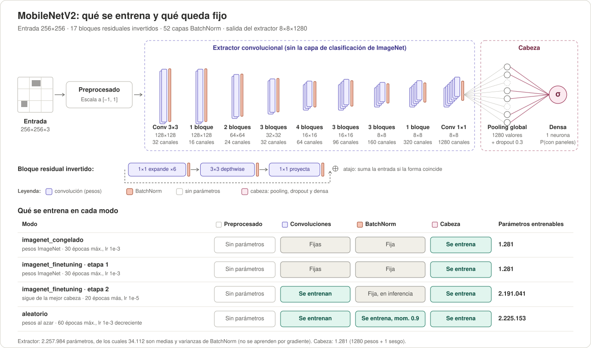
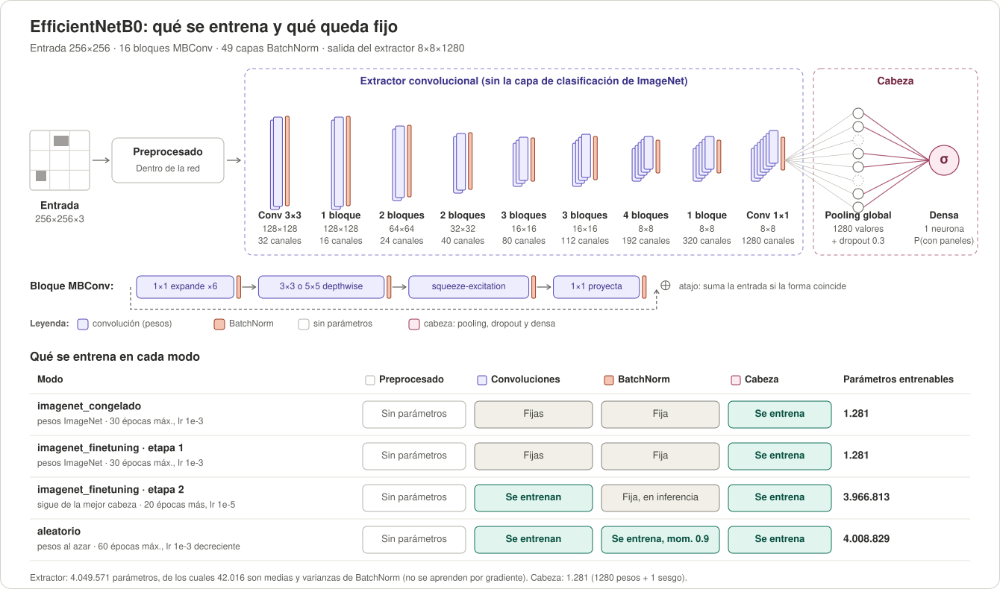
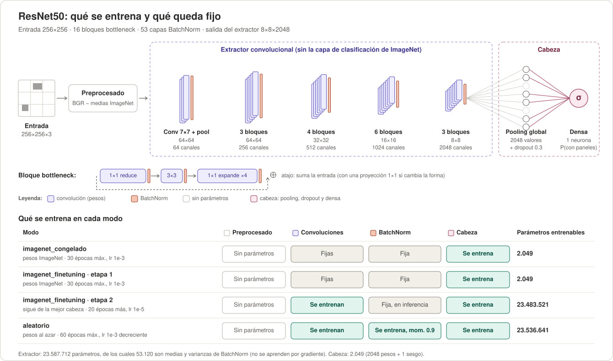

# Estructura de los clasificadores

Las tres CNN siguen la [receta común de clasificación](../README.md#receta-común-de-clasificación).
Este documento explica la arquitectura y sus etapas de entrenamiento.

Las tres redes tienen la misma estructura: preprocesado → extractor convolucional de Keras sin su capa de
clasificación de ImageNet → cabeza propia (pooling global, dropout 0.3 y una neurona sigmoide). Cambia solo el
extractor. En cada diagrama, la tabla de abajo muestra qué parte se entrena en cada modo; los parámetros
entrenables salen de las arquitecturas de Keras con entrada 256×256.

- **Fine-tuning en dos etapas:** primero se entrena solo la cabeza (igual que `imagenet_congelado`) y después
  se descongela el extractor con lr 1e-5. Así los gradientes de una cabeza al azar no arruinan los pesos de
  ImageNet.
- **BatchNorm queda fija con ImageNet, aun en fine-tuning:** no se entrenan sus γ y β, y la red se llama con
  `training=False`, así que usa las medias y varianzas de ImageNet y no las de cada batch de 32.
- **En `aleatorio` BatchNorm sí aprende**, con momentum 0.9 para que sus estadísticas se adapten rápido.

<b>MobileNetV2</b>

<b>EfficientNetB0</b>

<b>ResNet50</b>

