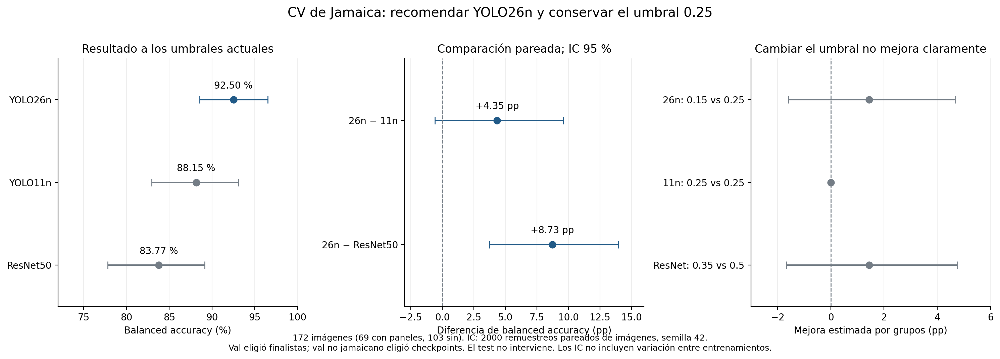

# Evaluación sobre Jamaica

El test es solo de Kingston, con capturas tipo Google Maps (issue #7): **200 imágenes, 125 con paneles y 75
sin**, no la mayoría sin paneles que se esperaba al principio. Evalúa **clasificación y detección**, con la
misma entrada que nuestro dataset (256×256, mismo zoom): no hay que cambiar el preprocesamiento. Este
documento reúne cómo se mide el desempeño en Jamaica antes del test. Nada de esto cambia el split fijo.

## Qué imágenes cuentan como Jamaica

`split.es_jamaica(nombre)`: `kingston_*`, `kingston2_*` y las `geo` con coordenadas dentro de Jamaica (hoy
son todas). Son 172 imágenes en 39 grupos espaciales:

| | Imágenes | Con paneles | Sin paneles | Grupos espaciales |
|---|---|---|---|---|
| train | 149 | 58 | 91 | 30 |
| val | 23 | 11 | 12 | 9 |

De los 39 grupos, 18 tienen al menos una imagen con paneles, 21 no tienen ninguna y 8 mezclan las dos.

## Paso 1 (ya implementado): métricas de val solo sobre Jamaica

`resultados.guardar_corrida` guarda en `metricas.json` la clave `jamaica` con las mismas métricas que el
total, calculadas solo sobre las 23 imágenes de Jamaica de val. `resultados.cargar_corridas` agrega las
columnas `jamaica.<métrica>` y las recalcula desde `predicciones_val.csv`, así que también aparecen en las
corridas guardadas antes del cambio, sin volver a entrenar.

**Limitación:** con 11 imágenes con paneles y 12 sin paneles, una sola imagen mueve el recall de cada clase
entre 8 y 9 puntos. Sirve para detectar problemas grandes, como el 59 % del issue #7, no para elegir entre
modelos parecidos.

## Paso 2: validación cruzada agrupada sobre Jamaica (issue #43)

Para medir con las 172 imágenes y no solo con 23:

1. Repartir las imágenes de Jamaica (train y val) en 5 folds con `StratifiedGroupKFold`, agrupando por zona
   espacial (`split.grupos_espaciales`) y estratificando por con/sin paneles. Así ninguna zona queda partida
   entre entrenamiento y evaluación.
2. En cada fold, entrenar con todo el train que no es de Jamaica más las imágenes de Jamaica de los otros
   4 folds, y predecir el fold que queda afuera.
3. Juntar las predicciones de los 5 folds: queda una predicción por cada una de las 172 imágenes, sin que
   ningún modelo haya visto la imagen ni sus vecinas.
4. Reportar recall con paneles, recall sin paneles y F1 macro, más el umbral elegido sobre esas predicciones
   (tarea de @Sciordia11 en el issue #7). Para esto alcanza con pasarle esas predicciones a
   `umbral.tabla_jamaica` (ver "Umbral de decisión" abajo).

**Costo:** 5 entrenamientos por configuración. Para los linear probes del notebook extra son segundos; para
las CNN en Colab conviene hacerlo solo con la receta común y las variantes finalistas, no con todas.

**Qué no cambia:** el split oficial sigue igual y las métricas de val del formato común se siguen
reportando como hasta ahora. Esto es una evaluación adicional.

### Particiones implementadas

`split.folds_jamaica(rutas, n=5, semilla=42)` audita los datos y devuelve una lista de cinco
diccionarios. Cada uno contiene `fold` (1 a 5) y tres tablas con las columnas del manifiesto:

- `train`: todo el train oficial no jamaicano más las imágenes de Jamaica de los otros cuatro folds.
- `validacion`: solo el val oficial **no jamaicano**, para elegir checkpoints y aplicar early stopping.
- `evaluacion`: el fold de Jamaica que queda afuera, para obtener las predicciones fuera de fold.

La agrupación espacial se calcula sobre todos los nombres oficiales juntos, antes de separar las
particiones, para conservar las cadenas de vecinos. La función frena si falta una clase, hay grupos
compartidos entre particiones, etiquetas pendientes en Jamaica o diferencias con los archivos del split.
No admite imágenes de un test externo ni escribe `splits/train.txt` o `splits/val.txt`.

La semilla 42 permuta los IDs de grupo usados para desempatar `StratifiedGroupKFold`, con
`shuffle=False`. Se mantiene la correspondencia entre cada grupo y sus recuentos de clase:
en [scikit-learn 1.7.2](https://github.com/scikit-learn/scikit-learn/blob/1.7.2/sklearn/model_selection/_split.py)
el `shuffle=True` interno permuta los recuentos sin permutar los índices que identifican sus imágenes.
En la comprobación local eso produjo folds con proporciones de positivos muy distintas; un test
con grupos de una sola clase controla la regresión. La estrategia queda registrada en `params`.
La estratificación sigue siendo aproximada: las zonas más grandes incluyen grupos de 30 negativos
y de 21 positivos, que limitan el equilibrio entre composición y tamaño. El notebook muestra la
distribución antes de entrenar; no se eligen particiones mirando métricas de los modelos ni el test.

El fold de `evaluacion` **no se pasa como validación al entrenamiento**: usarlo para elegir el mejor
checkpoint haría optimistas sus predicciones, aunque sus imágenes nunca entrenaran por gradiente.
Reservar el val no jamaicano permite entrenar con todas las imágenes de Jamaica de los otros cuatro
folds, como pide el issue, conservando los hiperparámetros y el criterio de checkpoint de cada receta.
Es una limitación del diseño: ese conjunto selecciona épocas por rendimiento fuera de Jamaica.
El val común se usó para elegir los finalistas y también para reportar; la CV adicional no elimina
por completo ese sesgo de selección.

**Estado al 09/11/2026:** ResNet50, YOLO11n y YOLO26n tienen los cinco folds guardados.
El resultado y la decisión se documentan debajo: recomendar YOLO26n con umbral 0.25 y conservar
ResNet50/0.5 como CNN de referencia. El flujo autorizado del notebook 16 no cambia las reglas
de las corridas comunes. No se cargó el test para esta decisión.

El 06/11/2026 la usuaria comunicó la decisión del equipo: **N06 no tiene paneles**. Se registra como
`revisado_equipo` y se conserva su etiqueta original vacía. En la CV se evalúa una vez y entra al
entrenamiento de los otros cuatro folds como negativa. La comprobación inicial se había detenido
por su revisión pendiente; se mantiene el control para cualquier nueva etiqueta dudosa de Jamaica.
N16 no es de Jamaica y permanece en la validación no jamaicana, con su referencia provisional.

### Ejecutar y guardar la CV

- Una arquitectura por sesión nueva de Colab: ResNet50, YOLO11n, YOLO26n y MobileNetV2 opcional.
  Cada ejecución entrena a lo sumo un fold. Con `FOLDS = [1, 2, 3, 4, 5]` se saltean los completos
  y se toma el primero pendiente, sin tener que recordar cuál terminó.
  Las CNN usan `requirements-training.txt`; YOLO11n usa `requirements-detection.txt` (8.3.221)
  y YOLO26n usa `requirements-yolo26.txt` (8.4.184). Las versiones efectivas se registran.
- `ENTRENAR=False` permite analizar sin GPU y con Drive en solo lectura. Para entrenar, activar T4,
  elegir `MODELO`, `FOLDS` y `ENTRENAR=True`. El test de Kingston nunca se carga.
- La receta se lee de la corrida de referencia completa en Drive. En las CNN se verifican ambas
  etapas contra `comun_v2`. **No se cargan pesos de esas corridas**: cada fold comienza desde
  ImageNet/COCO y la cabeza de fine-tuning se aprende dentro de ese fold.
- Se recalculan los pesos por fuente × clase solo con train de cada fold. Los máximos de épocas,
  paciencia, aumentación y LR conservan la receta. Los pesos CNN de menor `val_loss` se restauran
  desde memoria; YOLO conserva su criterio nativo de mejor checkpoint y registra la época real.
- Cada fold se guarda en `analisis/cv_jamaica/<modelo>/<modo>/fold_N/`, con pesos, `config.json`
  (receta, referencia, entorno, huella de datos y commit), `particiones.csv`, `entrenamiento.json`
  (mejores épocas por etapa), `predicciones_oof.csv`, historiales y `completo.json` (SHA-256).
  Los detectores además guardan `cajas_oof.csv` y los argumentos efectivos. No entra en la tabla
  de corridas comunes ni se usa `resultados.guardar_corrida`.
- Las CNN guardan al final de cada época en `fold_N/reanudacion/`: modelo completo con Adam,
  mejores pesos, historial, paciencia y commits de ejecución. Dos copias alternas con SHA-256
  permiten recuperar la anterior si una escritura se interrumpe. No se borran los checkpoints;
  ocupan espacio adicional en Drive. Se trabaja con copias locales de los modelos.
  Después de un corte: sesión T4 nueva, mismo modelo y `REPETIR=False`. Se recupera la última
  época íntegra; no se repiten etapas terminadas ni se reinicia Adam o la paciencia. Si nunca
  se creó la carpeta de checkpoints (versión anterior o corte antes del primer guardado), se archiva el parcial
  y ese fold empieza desde ImageNet. Un checkpoint corrupto sin otra copia íntegra frena.
  El flujo aleatorio del dataset puede cambiar al reanudar; no se promete reproducción bit a bit.
  El tiempo acumulado cuenta las épocas guardadas, no el trabajo perdido durante un corte.
- Los checkpoints de YOLO siguen siendo locales. Para repetir su fold interrumpido, seleccionar
  solo ese fold y `REPETIR=True` para archivarlo; después volver a `False`. No se borran archivos.
- La lectura exige los cinco folds completos del mismo modelo, receta, entorno, datos y versión
  de entrenamiento. Las CNN del commit `c1ffe523d2b6233a707cd7fbcd34f1e0c21ddbc4` son compatibles
  con `jamaica_cnn_comun_v2_v1`: solo se agregó persistencia, sin cambiar la receta. Se conserva
  el commit original de cada fold y se registran los commits de ejecución al reanudar. Otros
  formatos antiguos y los detectores siguen exigiendo el mismo commit exacto. Si cambia el
  entrenamiento, debe cambiar `VERSION_CNN`; la equivalencia no autoriza cambios de receta.
  No agrega resultados parciales. Una imagen de Jamaica debe aparecer exactamente una vez; un
  archivo alterado o una configuración mezclada produce error.

### Resultado de CV y decisión (09/11/2026)

Se leyeron de Drive los **15 folds** de ResNet50, YOLO11n y YOLO26n. Cada modelo tiene
exactamente las mismas **172 imágenes** fuera de fold (69 con paneles y 103 sin), sin duplicados,
con etiquetas y particiones coincidentes. MobileNetV2 era opcional y no se ejecutó.
**Esta decisión no usa imágenes ni métricas del test.**

**Recomendación para presencia de paneles: `yolo26n/coco_completo`, umbral 0.25.**
Por familia, se conserva ResNet50/0.5 como CNN y se elige YOLO26n/0.25 como detector.
La CNN es el único finalista de su familia ejecutado; no se afirma superioridad frente a MobileNetV2.

#### Clasificación sobre las 172 predicciones fuera de fold

La balanced accuracy es el criterio principal. Los intervalos del 95 % usan el procedimiento
previsto en `comparacion.intervalos`: 2000 remuestreos de imágenes, semilla 42. F1 macro,
recall de cada clase y AUC se muestran como complemento. **Val eligió los finalistas y se usó
para reportar; el val no jamaicano eligió los checkpoints de esta CV.**

| Modelo | Umbral | Balanced accuracy [IC 95 %] | F1 macro | Recall con paneles | Recall sin paneles | AUC |
|---|---:|---|---:|---:|---:|---:|
| ResNet50 | 0.5 | 0.8377 [0.7781, 0.8914] | 0.8283 | 0.8696 | 0.8058 | 0.9192 |
| YOLO11n | 0.25 | 0.8815 [0.8295, 0.9306] | 0.8887 | 0.8116 | 0.9515 | 0.9268 |
| YOLO26n | 0.25 | 0.9250 [0.8855, 0.9654] | 0.9270 | 0.8986 | 0.9515 | 0.9724 |

Intervalos complementarios, calculados con los mismos remuestreos:

| Métrica [IC 95 %] | ResNet50 | YOLO11n | YOLO26n |
|---|---|---|---|
| F1 macro | 0.8283 [0.7666, 0.8829] | 0.8887 [0.8381, 0.9347] | 0.9270 [0.8880, 0.9640] |
| Recall con paneles | 0.8696 [0.7857, 0.9429] | 0.8116 [0.7183, 0.9014] | 0.8986 [0.8261, 0.9688] |
| Recall sin paneles | 0.8058 [0.7247, 0.8785] | 0.9515 [0.9062, 0.9899] | 0.9515 [0.9072, 0.9900] |
| AUC | 0.9192 [0.8723, 0.9585] | 0.9268 [0.8836, 0.9653] | 0.9724 [0.9455, 0.9925] |

A los umbrales de referencia, ResNet50 tiene 20 falsos positivos y 9 falsos negativos;
YOLO11n, 5 y 13; YOLO26n, 5 y 7, respectivamente. Las CNN reciben 256 px y los YOLO 640 px:
se comparan los enfoques completos, no se atribuye toda la diferencia solo a la arquitectura.
El puntaje de YOLO es la máxima confianza de sus cajas, no una probabilidad calibrada.
El umbral recomendado se aplica a ese puntaje para decidir presencia de paneles; no cambia
el `conf` de inferencia guardado en la receta, que permite conservar cajas para calcular mAP.

#### Diferencias pareadas y elección del modelo

| Comparación | Diferencia de balanced accuracy (pp) | IC 95 % (pp) | Diferencia clara |
|---|---:|---|---|
| YOLO11n − ResNet50 | +4.38 | [-1.51, +10.50] | no |
| YOLO26n − ResNet50 | +8.73 | [+3.72, +13.94] | sí |
| YOLO26n − YOLO11n | +4.35 | [-0.58, +9.62] | no |

YOLO26n tiene el mejor valor observado y supera a ResNet50 con el intervalo previsto que
excluye cero. **Frente a YOLO11n, la ventaja de +4.35 pp no es concluyente.** Se aplica el
desempate por **menor mediana del tiempo registrado por fold**, como implementa el notebook 17:
YOLO26n, 699.16 s; YOLO11n, 721.30 s. Por eso se recomienda YOLO26n, sin afirmar superioridad
estadística entre los dos detectores. La diferencia de tiempo es pequeña y no es un benchmark
de latencia de inferencia ni una prueba de menor costo en toda situación.

Como comprobación exploratoria de sensibilidad se remuestrearon las **39 zonas completas**,
con 2000 réplicas y semilla 42, conservando las mismas zonas para cada modelo de una réplica.
La conclusión se mantiene: YOLO26n − ResNet50 tiene IC [+1.67, +14.34] pp y
YOLO26n − YOLO11n, [−0.93, +13.90] pp. Esta comprobación complementa el bootstrap de imágenes;
no reemplaza la regla de selección fijada ni mide variación entre nuevos entrenamientos.

#### Umbral: conservar 0.25 en YOLO26n

Se usa la grilla original 0.05–0.95, paso 0.05. El candidato maximiza balanced accuracy;
su evaluación `*_cv` elige el umbral dejando afuera una zona por vez. La mejora se compara
pareadamente con **0.5 para ResNet y 0.25 para YOLO**, no con un umbral común arbitrario.

| Modelo | Referencia | Candidato con las 172 imágenes | Balanced accuracy `*_cv` | Mejora `*_cv` e IC 95 % (pp) | Umbral recomendado |
|---|---:|---:|---:|---|---:|
| ResNet50 | 0.5 | 0.35 | 0.8521 | +1.44 [-1.67, +4.74] | 0.5 |
| YOLO11n | 0.25 | 0.25 | 0.8815 | +0.00 [+0.00, +0.00] | 0.25 |
| YOLO26n | 0.25 | 0.15 | 0.9394 | +1.44 [-1.60, +4.67] | 0.25 |

En YOLO26n, 0.15 es el máximo observado y se repite al dejar zonas afuera. Frente a 0.25,
reduce los falsos negativos de 7 a 3, pero aumenta los falsos positivos de 5 a 8.
La mejora estimada es +1.44 pp con IC [−1.60, +4.67]: **no es clara**, por lo que la regla
predefinida conserva **0.25**. No se presenta 0.15 como un óptimo generalizable.
ResNet50 conserva 0.5 por el mismo criterio; YOLO11n ya tiene 0.25 como candidato y referencia.

`*_cv` no es una CV anidada completa: los modelos que produjeron predicciones de otros folds
comparten imágenes de entrenamiento. Los intervalos no corrigen ese efecto, ni la selección
previa de finalistas con val. Tampoco incluyen la variación de volver a entrenar cada modelo.

#### Detección y costo observado

El mAP se calcula sobre las cajas fuera de fold **reunidas**, con las 134 cajas reales de las
172 imágenes; no es el promedio de los mAP de folds. No se calculó un intervalo para esta
diferencia de mAP y no se usó como sustituto del criterio principal de balanced accuracy.

| Detector | mAP50 | mAP50–95 |
|---|---:|---:|
| YOLO11n | 0.5197 | 0.2846 |
| YOLO26n | 0.7084 | 0.3791 |

| Modelo | Mediana de segundos por fold | Total de minutos de los cinco folds |
|---|---:|---:|
| ResNet50 | 411.22 | 34.21 |
| YOLO11n | 721.30 | 51.59 |
| YOLO26n | 699.16 | 49.41 |

Los tiempos son los registrados por las corridas, incluyen entrenamiento e inferencia y dependen
del entorno y del early stopping. Ambos YOLO registran Tesla T4; las CNN solo registraron el
dispositivo GPU, sin identificar el modelo de tarjeta. Las mejores épocas medianas son:
ResNet50, cabeza 11/fine-tuning 10; YOLO11n, 48; YOLO26n, 37. No se reentrenó ningún modelo
ni se evaluó el test durante este análisis.

#### Fuentes, verificación y reproducción

- [ResNet50 en Drive](https://drive.google.com/drive/folders/13thFkbcWSZKBHGY-fqDNghf0iwxCvm22),
  commit de entrenamiento `c1ffe523d2b6233a707cd7fbcd34f1e0c21ddbc4`.
- [YOLO11n en Drive](https://drive.google.com/drive/folders/1sfrnhpNdw0ZTKKHT8wUC9Lb64ujncsSr) y
  [YOLO26n en Drive](https://drive.google.com/drive/folders/1OoxxttJpwcYrDOoXYFcGBpWAH5i6VGbq),
  commit de entrenamiento `c5cb6f15d6e02e391509cc7013c097f008ca78a5` en ambos.
- Las cinco configuraciones coinciden dentro de cada modelo, incluidas las versiones de paquetes.
  Los YOLO comparten toda la receta y el entorno registrado salvo Ultralytics: 8.3.221 frente a
  8.4.184. Esa diferencia limita atribuir el resultado exclusivamente a la arquitectura.
- Se verificaron contra los originales locales las etiquetas, roles, separación espacial y huellas
  de datos, y los SHA-256 de configuraciones, particiones, historiales, registros de entrenamiento,
  predicciones y cajas. Las serializaciones de Colab se reprodujeron con saltos LF desde Windows.
  Se constató la existencia y el tamaño de los pesos; **no se recalculó el SHA-256 de todos los
  binarios** por límites de descarga. Las métricas se recalcularon desde las predicciones selladas,
  sin volver a ejecutar inferencia sobre los pesos.
- Huella de datos: `bb18b2f0612fb0697b21ac2eb0cf27bacb12538b815b8cc0739f3be095e30652`.
- Para reproducir las tablas principales: ejecutar el notebook 16 con `ENTRENAR=False` y luego el
  17, ambos en solo lectura. Usan `comparacion.intervalos`, `comparacion.diferencias`,
  `cv_jamaica.tabla_umbrales` y `deteccion.map_cajas`. Los valores puntuales de balanced accuracy,
  F1 macro y AUC también se contrastaron con scikit-learn.

La [elección documentada](modelo_final.md) reemplaza la selección provisional que se hizo cuando
YOLO26n solo tenía un fold. La evaluación final sigue siendo una tarea posterior: no elegir ni
cambiar modelos o umbrales después de consultar el test.

## Umbral de decisión (implementado)

Train tiene 85 % con paneles y el test 62.5 %: 0.5 no tiene por qué ser el mejor
umbral para Kingston. `pdi_tp/umbral.py` elige el umbral para Jamaica y mide si mejora algo:

- **Criterio: balanced accuracy** (promedio del acierto de cada clase). No depende de la proporción de clases,
  así que sirve aunque el test tenga otra proporción que val. La F1 macro sí depende: se reporta pero no se
  usa para elegir. Los candidatos van de 0.05 a 0.95 de a 0.05; si empatan varios, se toma el medio del tramo.
- **Estimación honesta:** elegir el umbral y medir sobre las mismas imágenes da un número optimista. Por eso
  se deja afuera un grupo espacial por vez, se elige el umbral con el resto y se aplica al grupo que quedó
  afuera (columnas `*_cv`). El umbral para el test (`umbral`) se elige con todas las imágenes.
- **Dónde se ve:** `umbral.tabla_jamaica(resultados.cargar_predicciones(rutas))` da una fila por modelo/modo
  de todo el equipo. La sección *Kingston* del notebook `05_clasificacion_mobilenetv2` la muestra.
- **No cambia las corridas:** el umbral guardado en `metricas.json` sigue siendo 0.5. Es una evaluación
  adicional.

La evaluación histórica usó 23 imágenes de Jamaica de val (9 grupos). El resultado de CV anterior
usa ya las 172 predicciones fuera de fold, con las limitaciones metodológicas indicadas.

### Resultado (27/10/2026): se deja 0.5

Balanced accuracy sobre las 23 imágenes de Jamaica de val (11 con paneles, 12 sin), con las corridas
guardadas en Drive a esa fecha. Val también se usó para elegir época y modo, así que todo es algo optimista.

| Corrida | Acierto con / sin (0.5) | Bal. acc. 0.5 | Bal. acc. umbral elegido (honesta) | Umbral según el grupo |
|---|---|---|---|---|
| resnet50 / imagenet_cabeza | 0.73 / 1.00 | 0.864 | 0.818 | 0.53 – 0.70 |
| mobilenetv2 / imagenet_fine_tuning | 0.73 / 0.92 | 0.822 | 0.689 | 0.25 – 0.80 |
| resnet50 / imagenet_finetuning | 0.73 / 0.83 | 0.780 | 0.780 | 0.30 – 0.78 |
| mobilenetv2 / imagenet_congelado | 0.73 / 0.83 | 0.780 | 0.602 | 0.23 – 0.83 |
| mobilenetv2 / imagenet_ft_completo | 0.64 / 0.83 | 0.735 | 0.644 | 0.18 – 0.75 |
| efficientnetb0 / imagenet_congelado | 0.64 / 0.83 | 0.735 | 0.481 | 0.10 – 0.78 |
| efficientnetb0 / imagenet_finetuning | 0.55 / 0.92 | 0.731 | 0.470 | 0.15 – 0.78 |
| resnet50 / aleatorio | 0.45 / 0.67 | 0.561 | 0.564 | 0.35 – 0.58 |
| baseline / siempre_con_paneles | 1.00 / 0.00 | 0.500 | 0.500 | 0.50 |
| efficientnetb0 / aleatorio | 1.00 / 0.00 | 0.500 | 0.447 | 0.35 – 0.80 |

- **En Jamaica los modelos se pierden paneles:** con 0.5 aciertan casi todas las imágenes sin paneles y entre
  el 45 % y el 73 % de las que tienen. Coincide con el diagnóstico del issue #7 ("parece Kingston → no tiene
  paneles").
- **Elegir el umbral no mejora:** la estimación honesta es igual o peor que 0.5 en todas las corridas
  (salvo resnet50/aleatorio, que es ruido), y el umbral elegido cambia mucho según el grupo que queda afuera.
  Con 23 imágenes, el umbral "óptimo" se ajusta a esas imágenes y no generaliza.
- **Ningún modelo se separa claramente:** una imagen mueve la balanced accuracy unos 0.04, que es la
  diferencia entre los dos primeros.
- **Decisión:** se usa 0.5. El problema de Kingston se ataca con el entrenamiento (balanceo por fuente y más
  capturas de Kingston), no con el umbral. Revisar el umbral cuando haya predicciones sobre las 172 imágenes
  o un test propio de Kingston, y después del balanceo por fuente, que cambia las probabilidades.
- Las corridas de EfficientNet pueden ser anteriores a los arreglos de fine-tuning, pesos de clase y
  BatchNorm: revisar la fecha en su `config.json` antes de sacar conclusiones sobre ese modelo.

## Paso 3 (implementado): test propio de Kingston

Las 200 capturas de Kingston quedaron como **test propio que no se usa ni para entrenar ni para elegir
umbral o modelo**, con cajas etiquetadas a mano (178) con el criterio del train. Están en Drive,
`PDI-TP/test_kingston/`, fuera del repo, y se evalúan con `18_evaluacion_test` (antes era el 17).

El 6/11 se hizo una corrida preliminar del test (entonces era el notebook 17) con las corridas que había en Drive, que todavía mezclaban
recetas (YOLOv8n a 256 px y el modo viejo `resnet50/imagenet_cabeza`). **No elegir modelos ni umbrales
mirando esos números.** Cuando estén fijados los modelos finales, fijarlos en `17_modelo_final`, volver a correr el 18 una sola vez y
aclarar en el informe que hubo esa evaluación preliminar.

## Detección

Lo de arriba vale igual para el detector, con dos diferencias:

- **Pocas cajas de Kingston:** 113 en 58 imágenes de train y 21 en 11 imágenes de val. Un mAP solo sobre
  Jamaica de val es todavía más ruidoso que las métricas de clasificación.
- **Las imágenes sin paneles de Jamaica** (`kingston2_*` y la mayoría de `geo`) entran al entrenamiento como
  imágenes de fondo y ayudan a bajar los falsos positivos (en el test, 75 de las 200 imágenes no tienen paneles).

Qué reportan los notebooks de detección (08–10):

1. mAP50 y mAP50-95 sobre todo val y **también solo sobre las imágenes de Jamaica de val** (por ejemplo, con
   un segundo `data.yaml` que liste solo esas imágenes, elegidas con `split.es_jamaica`).
2. El detector usado como clasificador se guarda con `resultados.guardar_corrida`, así que ya trae las
   métricas `jamaica` sin hacer nada extra.
3. Para la validación cruzada del paso 2 y el test propio del paso 3, las capturas nuevas tienen que venir
   **con cajas** en formato YOLO, no solo con la etiqueta con/sin paneles.

## Decisiones

- **Paso 2:** implementado en `16_validacion_cruzada_jamaica` (issue #43), para los finalistas que salgan
  del 15. Queda por decidir si se corre antes de la entrega.
- **Capturas nuevas:** las 200 van a test propio; ninguna se usa para entrenar.
