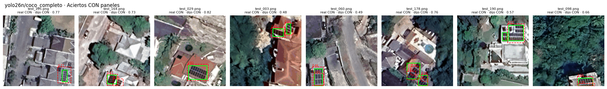
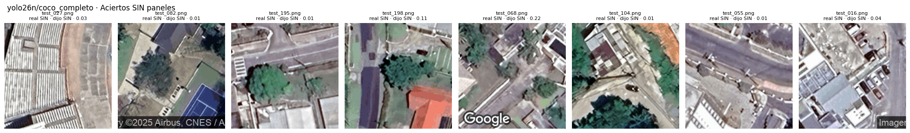

# Modelo final (issue #45)

## Elección actualizada con la CV completa (09/11/2026)

Con los cinco folds de cada uno de los tres finalistas, se recomienda **YOLO26n con umbral 0.25**
para presencia de paneles y como detector. Se conserva **ResNet50 con umbral 0.5** como CNN
para comparar los dos enfoques de la consigna. El análisis completo y sus fuentes están en
[`evaluacion_jamaica.md`](evaluacion_jamaica.md#resultado-de-cv-y-decisión-09112026).

La comparación se recalculó leyendo los registros de Drive y los originales del train/val,
en la rama de análisis basada en `main` `eda1da1`. **El test no se cargó ni se usó para elegir.**

## Regla aplicada

1. Finalistas del #43 elegidos en val: ResNet50 con fine-tuning, YOLO11n completo y YOLO26n
   completo; MobileNetV2 con fine-tuning era opcional y no se corrió.
2. Comparar balanced accuracy de las 172 predicciones fuera de fold, a 0.5 en CNN y 0.25 en YOLO.
3. Si el intervalo pareado entre los detectores incluye cero, elegir el de menor **mediana de
   segundos por fold**, como implementa `17_modelo_final`.
4. Cambiar el umbral solo si la mejora estimada por grupos es clara frente a su referencia.

## Modelos y umbrales recomendados

| | CNN | Detector usado como clasificador |
|---|---|---|
| Modelo | `resnet50/imagenet_finetuning` | `yolo26n/coco_completo` |
| Motivo | único finalista CNN ejecutado | diferencia no concluyente frente a YOLO11n; menor mediana de tiempo observada |
| Umbral | 0.5 | 0.25 |
| Balanced accuracy CV [IC 95 %] | 0.8377 [0.7781, 0.8914] | 0.9250 [0.8855, 0.9654] |
| F1 macro CV | 0.8283 | 0.9270 |
| AUC CV | 0.9192 | 0.9724 |
| Mediana de segundos por fold | 411.22 | 699.16 |
| Mejores épocas, mediana | cabeza 11, fine-tuning 10 | 37 |

YOLO26n − YOLO11n tiene una diferencia de balanced accuracy de **+0.0435**, IC 95 %
**[−0.0058, +0.0962]**. La elección de detector aplica el desempate por tiempo observado:
699.16 s frente a 721.30 s. Esa pequeña diferencia no prueba una ventaja general de velocidad
ni sustituye una medición de latencia de inferencia.

Frente a ResNet50, YOLO26n mejora balanced accuracy en **+0.0873**, IC **[+0.0372, +0.1394]**.
La sensibilidad remuestreando zonas completas mantiene la conclusión. Son resultados de esta CV,
con finalistas elegidos en val y checkpoints seleccionados con val no jamaicano; no son resultados
del test independiente.

## Por qué no bajar el umbral a 0.15

En YOLO26n, 0.15 maximiza el resultado observado de la grilla y la estimación por grupos da
balanced accuracy **0.9394** frente a **0.9250** con 0.25. La mejora es **+0.0144**,
IC **[−0.0160, +0.0467]**: no es clara. Se conserva **0.25**, conforme a la regla previa.
Con 0.15 se pierden 3 imágenes con paneles y se generan 8 falsas alarmas; con 0.25, 7 y 5.
No se afirma haber encontrado un umbral óptimo universal.
El umbral es el de presencia de paneles sobre la máxima confianza de las cajas; no modifica
el parámetro `conf` de inferencia que conserva las cajas usadas para calcular mAP.

ResNet50 también conserva 0.5: su candidato 0.35 no produce una mejora clara. YOLO11n ya
elige 0.25. Las limitaciones de `*_cv`, que no es una CV anidada completa, están en el análisis.

## Selección anterior y evaluación final

La elección inicial del 09/11, hecha con `17_modelo_final` sobre `main` `585d7a9`, seleccionó
YOLO11n cuando YOLO26n solo tenía **1 de 5 folds**. Se registró la excepción de elegir al único
finalista completo, sin rival en la CV. Esa situación ya quedó superada; esta actualización
reemplaza aquella recomendación de detector con las corridas completas.

Este análisis **no reentrena modelos ni ejecuta el test** y no modifica archivos de Drive.
Para aplicar la elección, revisar el resultado actualizado de `17_modelo_final` y usar en el
notebook 18, antes de cualquier evaluación final:

```python
MODELOS_FINALES = {
    "clasificadores": "resnet50/imagenet_finetuning",
    "yolo26n": "yolo26n/coco_completo",
}
```

Para evaluar el detector seleccionado, usar **`FAMILIA = "yolo26n"`**: instala Ultralytics 8.4.184.
La opción `"detectores"` corresponde a YOLOv8n/YOLO11n y no sirve para abrir correctamente YOLO26n.

El notebook 18 ya configura esta elección y usa `SOLO_FINALES = True` para evaluar únicamente
el finalista de cada sesión. Comprueba el umbral guardado y reproduce las predicciones de val
antes de predecir el test; si el finalista no supera ese control, frena.
Se evalúan los pesos actuales, entrenados solo con train (738 imágenes), sin reentrenamiento
con train + val: es la alternativa prevista en el #45. Se recibió la salida completa de YOLO26n,
registrada abajo. Falta recuperar la salida de ResNet50 y reunir las predicciones por imagen
de ambos modelos para cerrar la comparación final.

Se mantiene el registro histórico: el 06/11 se hizo una corrida preliminar del test con las
corridas vigentes. Las decisiones de esta actualización salen solo de la CV; los resultados del
test se reportan con esa elección fijada, sin ajustar modelos ni umbrales. El reentrenamiento
final y la alternativa de usar modelos entrenados solo con train pertenecen al #45; completar
CV no significa haber reentrenado con train + val.

## Registro parcial del test final de Kingston

La salida recibida el **09/11/2026** del notebook `18_evaluacion_test` contiene únicamente
`yolo26n/coco_completo`, con `FAMILIA = "yolo26n"`, `SOLO_FINALES = True` y umbral **0.25**.
Las nueve celdas de código tienen salidas y no registran excepciones. La copia recibida se
conserva fuera de Git como `resultados_locales/18_evaluacion_test_yolo26n_con_salidas.ipynb`;
su SHA-256 es `4abe7858d7ae404b786a1a5470d1aa38bea0dd995cfb31ab202563e21f2abd4b`.
Las fuentes de todas sus celdas coinciden con el notebook del commit `ef2ddcf`. Esa comprobación
no identifica el commit del código importado en Colab: la salida no registra el commit de
ejecución ni las versiones efectivas instaladas. El setup informó que no había GPU.

El test controlado por el notebook tiene **200 imágenes de Kingston: 125 con paneles, 75 sin
paneles y 178 cajas**, anotadas por una persona. Los pesos provienen de la corrida del 06/11,
entrenada solo con las 738 imágenes de train; **val eligió los checkpoints y también se usa
para reportar**. La selección de finalistas partió de val y los modelos y umbrales finales se
fijaron con la CV de Jamaica antes de esta evaluación. El test no cambia esa elección.

### Control de carga de YOLO26n

La reproducción de las probabilidades guardadas de val dio `valida = True`,
`diferencia_max = 0.000003` (valor mostrado, con tolerancia 0.01) y `cambian_val = 0`.
La inferencia del test se ejecutó después de superar ese control.

### Presencia de paneles

Se transcriben los valores de las tablas guardadas, **redondeados a tres decimales**.
Los intervalos del test son bootstrap del 95 %, remuestreando las 200 imágenes; describen
la incertidumbre de este test, sin corregir la selección previa ni el etiquetado.

| Métrica | Val (162 imágenes) | Test (200 imágenes) | IC 95 % del test |
|---|---:|---:|---|
| F1 macro | 0.930 | 0.861 | [0.808, 0.910] |
| Balanced accuracy | 0.939 | 0.849 | [0.794, 0.901] |
| Recall sin paneles | 0.900 | 0.747 | [0.644, 0.844] |
| AUC | 0.980 | 0.951 | [0.916, 0.979] |

La matriz de confusión registra **56 aciertos sin paneles, 19 falsos positivos,
6 falsos negativos y 119 aciertos con paneles**. Las 25 imágenes mal clasificadas aparecen
también en el resumen de errores de la ejecución. El puntaje de presencia es la máxima
confianza de las cajas; no es una probabilidad calibrada.


### Localización de paneles

| Métrica de cajas | Val | Test |
|---|---:|---:|
| mAP50 | 0.883 | 0.651 |
| mAP50-95 | 0.580 | 0.232 |
| Precisión | — | 0.685 |
| Recall | — | 0.623 |

Los guiones indican valores que esa tabla de la salida no mostró. La precisión y el recall
de cajas corresponden al puntaje de F1 máximo, como en Ultralytics; **no son** las métricas
de presencia a umbral 0.25. Los mAP se calculan con `deteccion.map_cajas` y la entrada de
`predecir_como_val`; la salida no guarda intervalos de estas métricas. Se prioriza mAP50;
mAP50-95 es sensible al ajuste de las cajas, que en este test dibujó una sola persona.

### Ejemplos conservados

Las siguientes figuras se extrajeron de las salidas PNG del notebook, sin volver a predecir.
Verde indica las cajas anotadas y rojo las predichas con confianza mayor o igual a 0.25.
Los errores se ordenaron por confianza: se muestran los ocho falsos positivos más confiados
y los seis falsos negativos. Los aciertos son las muestras de ocho imágenes por clase que
seleccionó el notebook con semilla 42.






En los falsos negativos se observan grupos de paneles pequeños y varios cercanos al borde
de la imagen; entre los falsos positivos hay cubiertas con patrones repetidos. Son observaciones
visuales de estas muestras, no una explicación causal ni una revisión de las etiquetas.

### Qué falta para cerrar la comparación

El equipo informó haber ejecutado ResNet50, pero la copia recibida no conserva esa salida.
**No se registran métricas de test de ResNet50 ni una ventaja de un enfoque frente al otro**
hasta recuperar sus resultados. Para cerrar el informe faltan su control de carga, las métricas
con intervalos, la matriz de confusión y los ejemplos.

También faltan los CSV de predicciones de las 200 imágenes de ambos modelos. El notebook
recibido conserva tablas y figuras, pero no esas filas. Se necesitan para calcular con
`comparacion.diferencias` el intervalo pareado de la diferencia entre enfoques; no se puede
deducir de las métricas agregadas ni del solapamiento de sus intervalos individuales.
