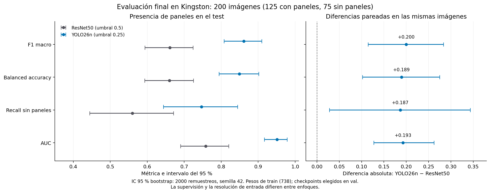
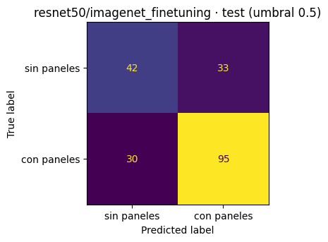
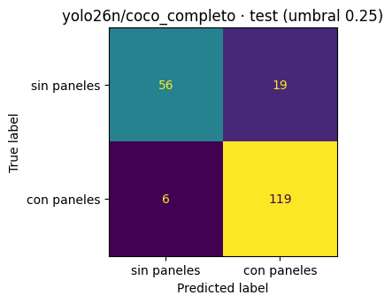
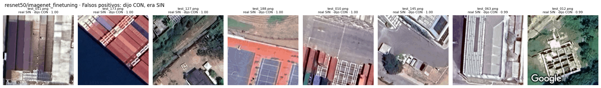
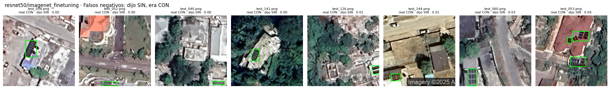
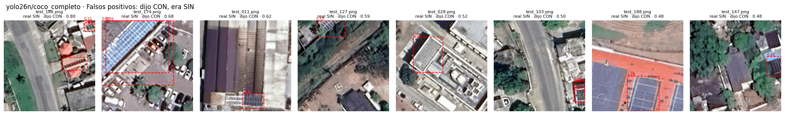
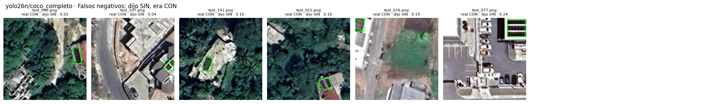

# Modelo final (issue #45)

## Elección actualizada con la CV completa (09/11/2026)

Con los cinco folds de cada uno de los tres finalistas, se recomienda **YOLO26n con umbral 0.25**
para presencia de paneles y como detector. Se conserva **ResNet50 con umbral 0.5** como CNN
para comparar los dos enfoques de la consigna. El análisis completo y sus fuentes están en
[`evaluacion_jamaica.md`](evaluacion_jamaica.md#resultado-de-cv-y-decisión-09112026).

La comparación se recalculó leyendo los registros de Drive y los originales del train/val,
en la rama de análisis basada en `main` `eda1da1`. **El test no se cargó ni se usó para elegir.**

## Regla aplicada

1. Finalistas del #43 elegidos en val: ResNet50 con fine-tuning, YOLO11n completo y YOLO26n
   completo; MobileNetV2 con fine-tuning era opcional y no se corrió.
2. Comparar balanced accuracy de las 172 predicciones fuera de fold, a 0.5 en CNN y 0.25 en YOLO.
3. Si el intervalo pareado entre los detectores incluye cero, elegir el de menor **mediana de
   segundos por fold**, como implementa `17_modelo_final`.
4. Cambiar el umbral solo si la mejora estimada por grupos es clara frente a su referencia.

## Modelos y umbrales recomendados

| | CNN | Detector usado como clasificador |
|---|---|---|
| Modelo | `resnet50/imagenet_finetuning` | `yolo26n/coco_completo` |
| Motivo | único finalista CNN ejecutado | diferencia no concluyente frente a YOLO11n; menor mediana de tiempo observada |
| Umbral | 0.5 | 0.25 |
| Balanced accuracy CV [IC 95 %] | 0.8377 [0.7781, 0.8914] | 0.9250 [0.8855, 0.9654] |
| F1 macro CV | 0.8283 | 0.9270 |
| AUC CV | 0.9192 | 0.9724 |
| Mediana de segundos por fold | 411.22 | 699.16 |
| Mejores épocas, mediana | cabeza 11, fine-tuning 10 | 37 |

YOLO26n − YOLO11n tiene una diferencia de balanced accuracy de **+0.0435**, IC 95 %
**[−0.0058, +0.0962]**. La elección de detector aplica el desempate por tiempo observado:
699.16 s frente a 721.30 s. Esa pequeña diferencia no prueba una ventaja general de velocidad
ni sustituye una medición de latencia de inferencia.

Frente a ResNet50, YOLO26n mejora balanced accuracy en **+0.0873**, IC **[+0.0372, +0.1394]**.
La sensibilidad remuestreando zonas completas mantiene la conclusión. Son resultados de esta CV,
con finalistas elegidos en val y checkpoints seleccionados con val no jamaicano; no son resultados
del test independiente.

## Por qué no bajar el umbral a 0.15

En YOLO26n, 0.15 maximiza el resultado observado de la grilla y la estimación por grupos da
balanced accuracy **0.9394** frente a **0.9250** con 0.25. La mejora es **+0.0144**,
IC **[−0.0160, +0.0467]**: no es clara. Se conserva **0.25**, conforme a la regla previa.
Con 0.15 se pierden 3 imágenes con paneles y se generan 8 falsas alarmas; con 0.25, 7 y 5.
No se afirma haber encontrado un umbral óptimo universal.
El umbral es el de presencia de paneles sobre la máxima confianza de las cajas; no modifica
el parámetro `conf` de inferencia que conserva las cajas usadas para calcular mAP.

ResNet50 también conserva 0.5: su candidato 0.35 no produce una mejora clara. YOLO11n ya
elige 0.25. Las limitaciones de `*_cv`, que no es una CV anidada completa, están en el análisis.

## Selección anterior y evaluación final

La elección inicial del 09/11, hecha con `17_modelo_final` sobre `main` `585d7a9`, seleccionó
YOLO11n cuando YOLO26n solo tenía **1 de 5 folds**. Se registró la excepción de elegir al único
finalista completo, sin rival en la CV. Esa situación ya quedó superada; esta actualización
reemplaza aquella recomendación de detector con las corridas completas.

El análisis de elección se hizo sin reentrenar ni cargar el test. La elección quedó configurada
en el notebook 18 antes de evaluar, con los siguientes finalistas:

```python
MODELOS_FINALES = {
    "clasificadores": "resnet50/imagenet_finetuning",
    "yolo26n": "yolo26n/coco_completo",
}
```

Para evaluar el detector seleccionado, usar **`FAMILIA = "yolo26n"`**: instala Ultralytics 8.4.184.
La opción `"detectores"` corresponde a YOLOv8n/YOLO11n y no sirve para abrir correctamente YOLO26n.

El notebook 18 ya configura esta elección y usa `SOLO_FINALES = True` para evaluar únicamente
el finalista de cada sesión. Comprueba el umbral guardado y reproduce las predicciones de val
antes de predecir el test; si el finalista no supera ese control, frena.
Se evalúan los pesos actuales, entrenados solo con train (738 imágenes), sin reentrenamiento
con train + val: es la alternativa prevista en el #45. Se recibieron y verificaron las salidas
completas y los CSV de predicciones de **ResNet50 y YOLO26n**. La comparación final queda
registrada abajo, sin modificar archivos de Drive.

Se mantiene el registro histórico: el 06/11 se hizo una corrida preliminar del test con las
corridas vigentes. Las decisiones de esta actualización salen solo de la CV; los resultados del
test se reportan con esa elección fijada, sin ajustar modelos ni umbrales. El reentrenamiento
final y la alternativa de usar modelos entrenados solo con train pertenecen al #45; completar
CV no significa haber reentrenado con train + val.

## Evaluación final en Kingston (09/11/2026)

La evaluación de los dos finalistas quedó documentada con sus notebooks ejecutados y las
predicciones de las mismas **200 imágenes de Kingston: 125 con paneles, 75 sin paneles y
178 cajas**, anotadas por una persona. En este test, la configuración de **YOLO26n obtiene
mejores resultados de presencia** que la de ResNet50 en las cuatro métricas reportadas;
los cuatro intervalos pareados de las diferencias excluyen cero. Es una comparación de
enfoques con distinta supervisión y resolución, no un experimento que aísle la arquitectura.

Se evaluaron `resnet50/imagenet_finetuning` a **0.5** y `yolo26n/coco_completo` a **0.25**,
con `SOLO_FINALES = True` en sesiones separadas. Los pesos son los de las corridas del 03/11
y del 06/11, respectivamente, entrenadas solo con las **738 imágenes de train**;
**val eligió los checkpoints y también se usa para reportar**. La selección de finalistas
partió de val y los modelos y umbrales finales se fijaron con la CV de Jamaica antes de esta
evaluación. Se conserva esa elección: el test no se usa para ajustar ningún parámetro.

### Controles y reproducción de las salidas

Ambos notebooks terminaron sin excepciones. La reproducción de las probabilidades guardadas
de val pasó el control con tolerancia 0.01 y no cambió ninguna etiqueta predicha:

| Corrida | Diferencia máxima mostrada | Válida | Cambios en val |
|---|---:|---|---:|
| `resnet50/imagenet_finetuning` | 0.000005 | Sí | 0 |
| `yolo26n/coco_completo` | 0.000003 | Sí | 0 |

Cada CSV contiene exactamente las 200 imágenes únicas del manifiesto, sus etiquetas reales
y predicciones consistentes con el umbral fijado. Con `comparacion.intervalos` se reprodujeron
las matrices de confusión y las cuatro métricas con sus intervalos de las salidas guardadas.
Esta comprobación y el cálculo pareado usaron las predicciones existentes, sin nueva inferencia.

### Presencia de paneles

Los valores de esta tabla se muestran a **tres decimales**, como en los notebooks. Los
intervalos del test son bootstrap del 95 %, con **2000 remuestreos de las 200 imágenes y
semilla 42** (`comparacion.intervalos`). Describen la incertidumbre de este conjunto,
sin corregir la selección previa, las dependencias espaciales ni posibles errores de anotación.

| Métrica | ResNet50 en val | ResNet50 en test [IC 95 %] | YOLO26n en val | YOLO26n en test [IC 95 %] |
|---|---:|---|---:|---|
| F1 macro | 0.848 | 0.661 [0.593, 0.724] | 0.930 | 0.861 [0.808, 0.910] |
| Balanced accuracy | 0.893 | 0.660 [0.593, 0.725] | 0.939 | 0.849 [0.794, 0.901] |
| Recall sin paneles | 0.850 | 0.560 [0.444, 0.671] | 0.900 | 0.747 [0.644, 0.844] |
| AUC | 0.957 | 0.758 [0.690, 0.820] | 0.980 | 0.951 [0.916, 0.979] |

Las cifras de val corresponden a 162 imágenes, usadas para elegir checkpoints y reportar;
las del test, a las 200 capturas de Kingston. La caída observada respecto de val aparece en
ambos enfoques y es mayor en ResNet50. El puntaje de YOLO es la máxima confianza de sus cajas,
no una probabilidad calibrada.

### Diferencias pareadas: YOLO26n menos ResNet50

Se calcularon con `comparacion.diferencias`, usando los valores completos de los CSV y los
mismos remuestreos para ambos modelos: 2000, semilla 42, nivel 0.95 y referencia ResNet50.
Los siguientes valores se redondean a **cuatro decimales** después de calcular la diferencia;
no se restaron las cifras redondeadas de las tablas individuales.

| Métrica | Diferencia | IC 95 % pareado |
|---|---:|---|
| F1 macro | +0.2000 | [+0.1148, +0.2836] |
| Balanced accuracy | +0.1893 | [+0.1022, +0.2750] |
| Recall sin paneles | +0.1867 | [+0.0282, +0.3433] |
| AUC | +0.1929 | [+0.1271, +0.2622] |

La diferencia de balanced accuracy es de **18.9 puntos porcentuales**, con IC 95 %
**[10.2, 27.5]**. El AUC también favorece a YOLO26n y permite comparar el ordenamiento de
los puntajes sin fijar un umbral común. La evidencia corresponde a estas configuraciones y
este test: el detector recibió cajas durante el entrenamiento y ve las imágenes agrandadas
a 640×640, mientras que la CNN recibe etiquetas por imagen a 256×256. La comparación no
permite atribuir la diferencia únicamente a la arquitectura ni medir por separado el aporte
de la supervisión, la resolución o el punto de operación (ver [README](../README.md#pendientes-para-el-informe)).



### Matrices de confusión y errores compartidos

ResNet50 obtuvo **42 aciertos sin paneles, 33 falsos positivos, 30 falsos negativos y
95 aciertos con paneles**: 63 errores. YOLO26n obtuvo **56 aciertos sin paneles,
19 falsos positivos, 6 falsos negativos y 119 aciertos con paneles**: 25 errores.





Al alinear los CSV por archivo, **ambos aciertan 122 imágenes y ambos fallan 10**;
YOLO26n acierta otras 53 que ResNet50 falla, y ResNet50 acierta otras 15 que YOLO26n falla.
Los errores compartidos son `test_010`, `test_011`, `test_048`, `test_076`, `test_107`,
`test_127`, `test_134`, `test_141`, `test_147` y `test_188` (archivos `.png`).

### Localización de paneles con YOLO26n

| Métrica de cajas | Val | Test |
|---|---:|---:|
| mAP50 | 0.883 | 0.651 |
| mAP50-95 | 0.580 | 0.232 |
| Precisión | — | 0.685 |
| Recall | — | 0.623 |

Los guiones indican valores que esa tabla de la salida no mostró. La precisión y el recall
de cajas corresponden al puntaje de F1 máximo, como en Ultralytics; son métricas de
localización, distintas de la decisión de presencia a umbral 0.25. Los mAP se calcularon con
`deteccion.map_cajas` y la entrada de `predecir_como_val`; la salida no conserva intervalos
de estas métricas. Se prioriza **mAP50 = 0.651**; mAP50-95 es sensible al ajuste de las cajas,
que en este test dibujó una sola persona. ResNet50 solo clasifica presencia y no produce cajas.

### Ejemplos conservados para el informe

Las figuras siguientes se extrajeron de los PNG de los notebooks, sin volver a predecir.
Verde indica las cajas anotadas; en YOLO, rojo indica las predichas con confianza de al
menos 0.25. Los errores se ordenaron por confianza: se muestran los ocho falsos positivos
y ocho falsos negativos más confiados de ResNet50, los ocho falsos positivos más confiados
de YOLO26n y sus seis falsos negativos completos.









También se conservaron las muestras de ocho aciertos por clase elegidas con semilla 42:

- ResNet50: [con paneles](figuras/test_kingston/resnet50_aciertos_con_paneles.png) y
  [sin paneles](figuras/test_kingston/resnet50_aciertos_sin_paneles.png).
- YOLO26n: [con paneles](figuras/test_kingston/yolo26n_aciertos_con_paneles.png) y
  [sin paneles](figuras/test_kingston/yolo26n_aciertos_sin_paneles.png).

En las muestras de falsos negativos hay grupos pequeños y varios cercanos al borde de la
imagen; entre los falsos positivos aparecen cubiertas con patrones repetidos. Son observaciones
visuales de estas muestras, no una explicación causal ni una revisión de las etiquetas.

### Fuentes, alcance y cierre

Las cuatro fuentes recibidas el 09/11/2026 se conservan en `resultados_locales/`, fuera de Git:

- `18_evaluacion_test_resnet.ipynb`, SHA-256
  `d78f9eb0e9387b5f94bf2a45d130bee0c0d48d0b43c4d48c9d7b4bf093bb9490`.
- `predicciones_test_resnet50.csv`, SHA-256
  `e0163daa7def04c1e9bce177f03f5b337885255dcfd561cc413b12dfec9cf1e8`.
- `18_evaluacion_test_yolo26n_con_salidas.ipynb`, SHA-256
  `4abe7858d7ae404b786a1a5470d1aa38bea0dd995cfb31ab202563e21f2abd4b`.
- `predicciones_test_yolo26n.csv`, SHA-256
  `ce0138c944fea13497594a61605ef020bb5fe00b3428d0130b5c28ceeae015b8`.

Las fuentes de las 17 celdas del flujo de evaluación coinciden con el notebook del commit
`ef2ddcf`, salvo el selector `FAMILIA` de ResNet50. Este último agrega la celda de descarga
de su CSV. Las salidas no registran el commit importado en Colab ni las versiones efectivas
instaladas; la coincidencia de las celdas no identifica esos datos. Ambos setups informaron
que no había GPU y no se midió latencia de inferencia. El recálculo se hizo con las funciones
de `pdi_tp/comparacion.py` del commit `51a593a`.

Se conserva el historial: hubo una evaluación preliminar el 06/11 y, tras perderse la primera
salida de ResNet50 del 09/11, se repitió su inferencia para recuperar el registro, con la misma
corrida y umbral fijados. No corresponde describir estas salidas como la primera observación
del test. La comparación documentada mantiene la selección previa y no motivó ajustes del modelo,
del umbral ni del test. Los intervalos por imagen tampoco resuelven la anotación por una sola
persona ni justifican extrapolar el desempeño a otras regiones.

**La evaluación y el registro de ambos enfoques están completos para la alternativa de pesos
entrenados solo con train del #45.** Queda trasladar estas tablas, figuras y limitaciones al
informe que se mantiene fuera del repo, y completar la revisión y el merge del PR según `AGENTS.md`.
